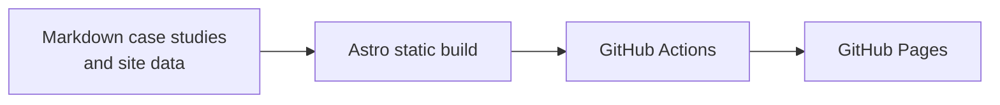

# John Well Arellano: portfolio website

Source for **https://iamjhnwll-ux.github.io**, the portfolio of John Well Arellano, Data Engineer specialising in Microsoft Fabric, medallion architecture, dimensional modelling, CI/CD and Power BI.

## What is inside

- Home page: services, a medallion architecture overview, selected work, skills, experience, certifications and contact.
- Case studies: one Markdown file per project in `src/content/work/`. They describe real work without client code or data.

## How it is built



- [Astro](https://astro.build) static site, plain CSS with light and dark themes, no client framework.
- Every push to `main` builds and deploys through GitHub Actions (`.github/workflows/deploy.yml`).

## Run locally

Requires Node 22.23.4 or later.

```bash
npm install
npm run dev
```

Build the production site into `dist/`:

```bash
npm run build
```

## Editing content

- Profile, impact figures, skills, experience and certifications: `src/data/site.js`
- Case studies: `src/content/work/*.md`
- Colours and fonts: `src/styles/global.css`

## Licence

Code is MIT licensed. The written content and case studies are © John Well Arellano.
